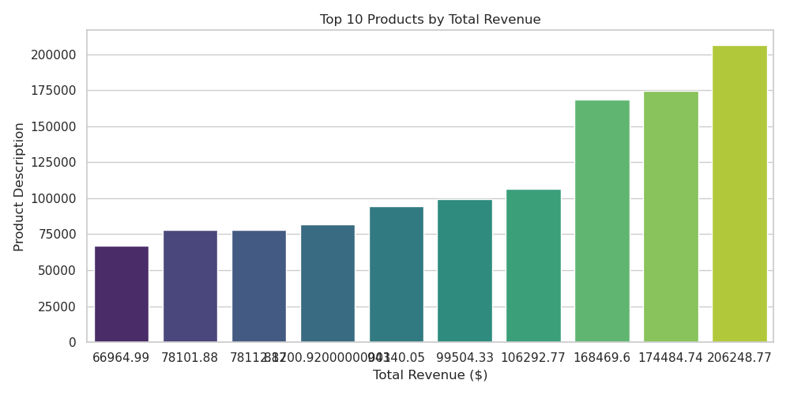
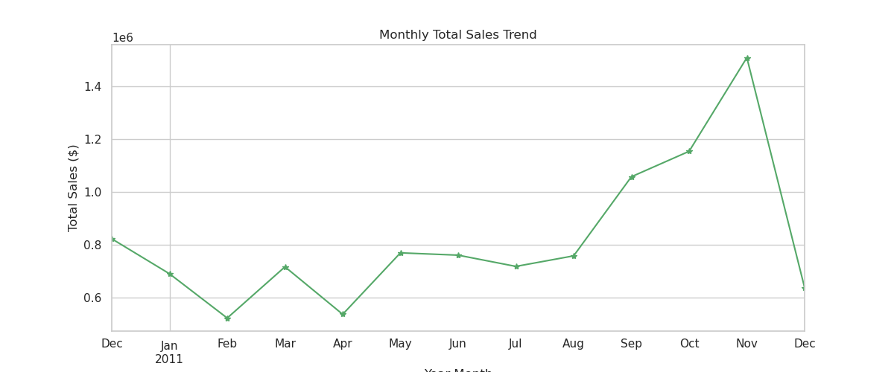
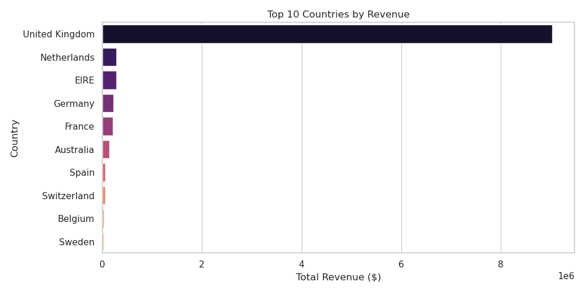

# E-Commerce Sales & Customer Transaction Analysis

## Project Overview
This project provides an end-to-end Exploratory Data Analysis (EDA) and data cleaning pipeline for an online retail dataset using **Pandas**, **Matplotlib**, and **Seaborn**. The dataset originally contains over 540,000 transactions.

---

## Data Cleaning Steps Applied
- Removed unnecessary columns (e.g., `CustomerID`).
- Dropped missing values (`NaN`) in product descriptions.
- Filtered out canceled orders (invoices starting with `'C'`).
- Cleaned invalid entries by filtering out negative or zero values in `Quantity` and `UnitPrice`.
- Engineered new features such as `TotalAmount` and extracted date components (`YearMonth`).

---

## Key Findings & Visualizations

### 1. Top 10 Revenue-Generating Products


### 2. Monthly Sales Trend


### 3. Top Countries by Total Revenue


---

## Tech Stack & Libraries
- **Language:** Python
- **Data Manipulation:** Pandas, NumPy
- **Data Visualization:** Matplotlib, Seaborn

---

##  How to Run locally
1. Clone this repository:
   ```bash
   git clone https://github.com/Ahmadali2005/ecommerce-data-analysis.git

## Install required dependencies

pip install pandas matplotlib seaborn
